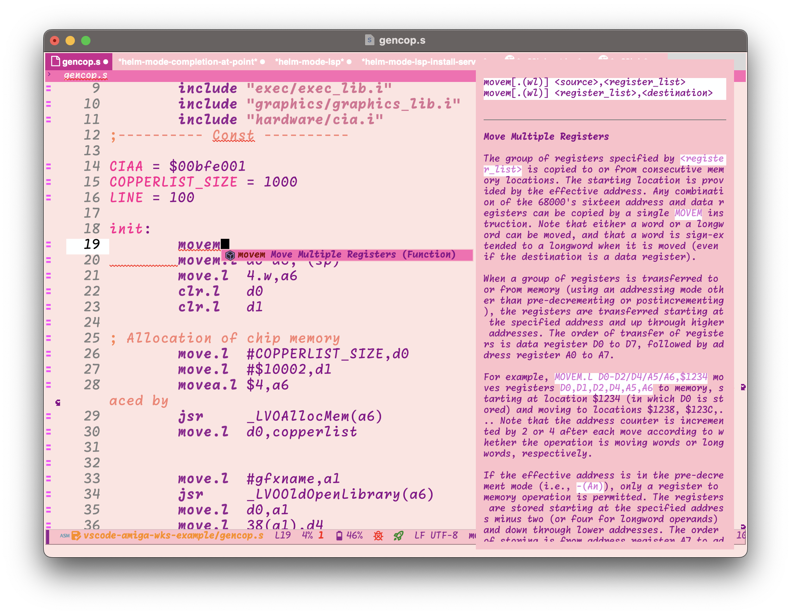
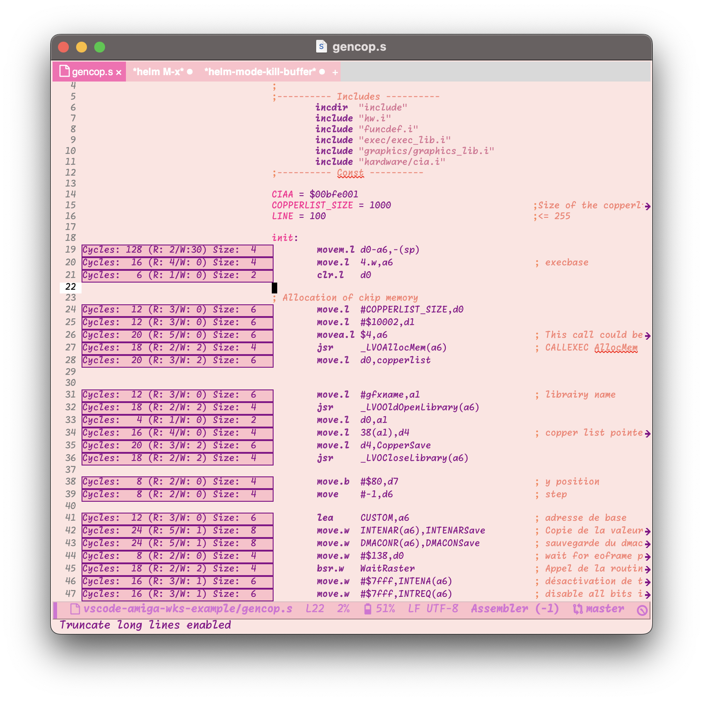

* M68K Mode for Emacs
Motorola 68k Assembly environment for Emacs. Focusing on Amiga in the beginning with lsp-server and debugger. Might extend to support other platforms based upon interest Includes setup for lsp-mode, and experimental dap-mode.

Example screenshot using my [[https://github.com/themkat/pink-bliss-uwu][pink-bliss-uwu theme]] and [[https://github.com/sebastiencs/company-box][company-box]] to get documentation during completion: 
#+ATTR_ORG: :width 600

(will probably look slightly different, and maybe more pleasant to you with another theme. If we wanted something standard, we would NOT be using Emacs but some cookie cutter IDE nonsense)

** Installation
Only manual is supported at the moment. You can help get this ready for something like MELPA by contributing :slightly_smiling_face:

*** Manual
Clone this repo and add it to your load-path, like so:
#+BEGIN_SRC emacs-lisp
  (add-to-list 'load-path "/path/to/repo")
  (require 'm68k-mode)
#+END_SRC

Note that =m68k-mode= depends on [[https://github.com/emacs-lsp/lsp-mode/][lsp-mode]]!

** Usage
You can simply activate =m68k-mode= for any buffers where you have a M68K assembly code. [[https://github.com/grahambates/m68k-lsp][Language server]] will be started automatically, and you will be prompted for installation if you have not installed it manually already.

#+BEGIN_QUOTE
[!TIP]
You can update your language server with M-x lsp-update-server
#+END_QUOTE

You can now use all supported LSP functionality for the server. Check [[https://github.com/grahambates/m68k-lsp][the server repo]] for more information on supported features. Most language server features should work right out of the box. Some examples:
- =lsp-format-buffer= for formatting
- lsp ui documentation popups on mouse hover and =lsp-ui-doc-show= / =lsp-ui-doc-hide=
- eldoc (i.e, minibuffer area) signature documentation for instructions/mnemonics.
  

*** Cycle Counter
There is an additional cycle counter you can opt in to using. Make sure you have NPM, and more specifically the NPX tool available (should be in all newer versions of NPM). Then in your config:
#+BEGIN_SRC emacs-lisp
  (require 'm68k-cycle-counter)
#+END_SRC

To get cycle counts as an overlay in your buffer, run =M-x m68k-cycle-counter-mode=. At the moment, the cycle counter does not run periodically, but this is planned. Just deactivate it, and activate it again to get new counts. (activation and deactivations are both the same command). Your buffer will then look similar to the following (or the theme might be different):

#+ATTR_ORG: :width 600

(I have disable truncation of lines to make it look prettier in this example. This is the same example code as above, and is taken from [[https://github.com/grahambates/vscode-amiga-wks-example][grahambates/vscode-amiga-wks-example]]

*** Experimental debugger
#+BEGIN_QUOTE
[!IMPORTANT]

Make sure you are using the patched FS UAE or WinUAE binaries instead of the default ones! They are needed to get the debugger to connect. This is documented in the [[https://github.com/grahambates/uae-dap][uae-dap]] readme. If you use the setup function below without any overrides, then the patched version is the default setting. You should also copy your kickstarts and other settings into the FS UAE kickstarts directory (or relevant WinUAE directories if you use Windows). This directory is usually found in your home directory.
#+END_QUOTE

The debugger is not enabled by default. To enable it, follow the installation instructions above, and add:
#+BEGIN_SRC emacs-lisp
  (require 'm68k-dap)
#+END_SRC

When it has been tested a bit more, it might be enabled by default as well. To debug, you will need to install the debug adapter and tooling. Make sure you have NPM installed, and run =M-x m68k-dap-uae-setup=. Emulators, like FS-UAE v4, is included in the tooling install. There might be some minor setup like putting Kickstart files in the correct directories if you have never used it before. 

Usage is like normal for [[https://github.com/emacs-lsp/dap-mode][dap-mode]] in Emacs: Simply run =dap-debug= and you are debugging! There is an included debug template where you are queried for the program to debug. This one is called =Amiga ASM debug=. Looking at it can provide some inspiration for your own config:
#+BEGIN_SRC emacs-lisp
  (dap-register-debug-template
   "Amiga ASM debug"
   (list :type "asm68k"
         :request "launch"))
#+END_SRC

If you want the program to be debugged to be coded in, just add =:program /path/to/compiled/exe= to a debug template. You can also use =.vscode/launch.json= configuration for the debugging, but not for a compilation task list. Make sure the debug configuration has the type =asm68k= for dap-mode to recognize it. 

If you want to compile before debugging, check the configuration section below.

**** Issues starting debugger/Timeout etc.
While uae-dap has some defaults for program discovery built in (i.e, =remoteProgram= set to =SYS:programname=), there seems like some users are experiencing issues. These issues typically manifest themselves as FS UAE being stuck at a AmigaDOS shell like when failing to boot the current disk. At the Emacs side, you  usually experience this as a timeout error. There is a simple workaround to fix it. Create a `s` directory in the same directory as your program, and put a =startup-sequence=
 file inside it. This file can contain a single command: =SYS:programname= (where =programname= is the same name as your executable).
 
** Configuration
- =m68k-format-case=: The case the formatter will format instructions and registers to. "lower", "upper" or "any".
- =m68k-processor-types=: A vector of processing types that should be used. Used to give correct completion and documentation based upon which processor. Example values: =["mc68000"]= (default) for plain 68k processor, =["mc68020", "mc68881"]= for a 68020 with a floating point processor etc.
- =m68k-include-paths=: Vector of include paths. Has the same effect as INCDIR in code. Example: =["/path/to/my/awesome/includes.i"]=. 

The debugger has the option to run compilation before debugging. To do so, set:
- =m68k-compile-command= to the command used to compile. Examples: =make build=, =./compile.sh= or similar. If the build fails, meaning the exit code is not 0, then the debugging will not start. If set to =nil=, no compilation will happen, and it will be your responsibility to do it manually before debugging.

** Contributing
All contributions welcome! Be kind, respectful, and constructive, and we will probably work good together :)

Feel free to report any issues you might have, and also feature requests. If we can make this a good package that create awesome M68K tooling for Emacs, then that would be awesome :slightly_smiling_face:

Steps for contributing code:
1. Fork this repo
2. Create branch with a fitting name for what you want to work with. example:  feature/tree-sitter-support, bugfix/
3. PR it with a descriptive title. Something like "Implemented tree-sitter syntax highlighting"
4. Discussion in comment, possible suggestions, and eventual merging if everything look good :)
